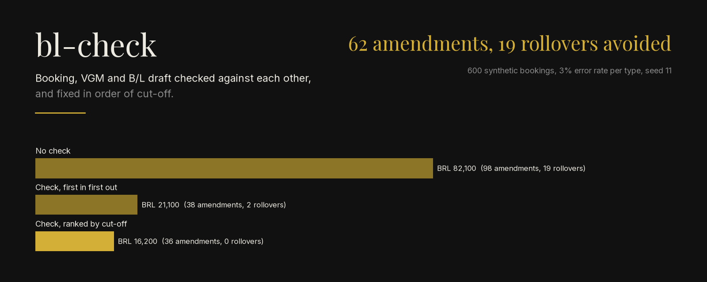
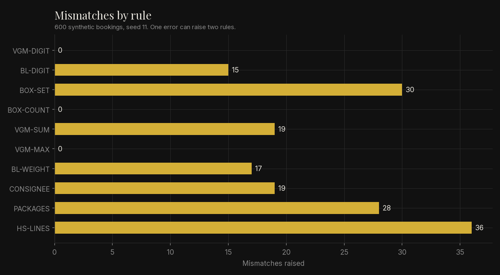
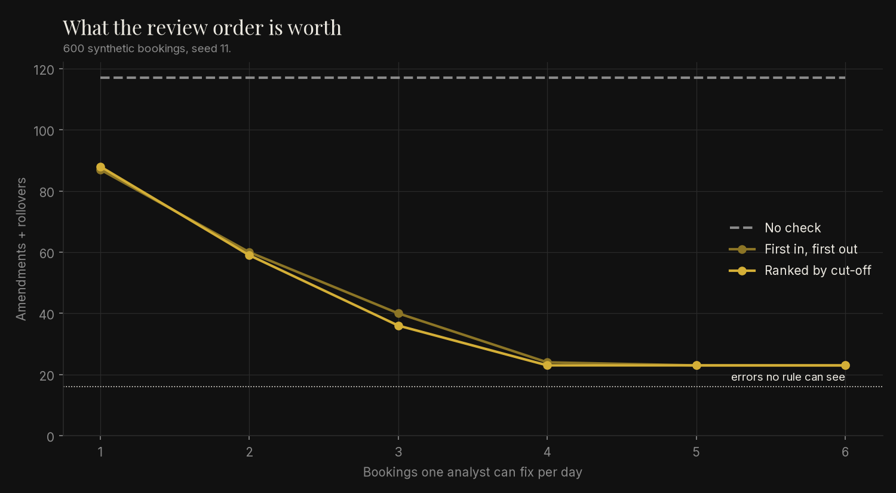

<p align="center">
  
</p>

<p align="center"><em>Synthetic data: 600 invented export bookings, errors injected at 3% per type, seed 11. Not documents from any shipper or line.</em></p>

Checks the booking, the VGM and the B/L draft of each export shipment against each other,
lists every mismatch with the hours left to its cut-off, and measures the amendments and
rollovers that are avoided.

```bash
pip install -e ".[dev]"
python -m bl_check simulate                   # 98 amendments, 19 rollovers -> 36 and 0
pytest                                        # 100% coverage required
```

## Problem

The same shipment is typed three times: in the booking, in the VGM and in the B/L draft. A
container number with one wrong digit, a VGM that does not add up or a consignee spelled
differently is usually found after the cut-off, when it costs an amendment fee or the box
misses the ship.

## Method

1. **Documents** (`models.py`): booking, one VGM per container and the draft, validated
   with pydantic whether they come from a file or over HTTP.
2. **Rules** (`rules.json`, `engine.py`): ten rules in JSON, each naming a check, the
   document it belongs to, a severity and its tolerance. Checks cover the SOLAS VGM sum,
   maximum gross mass, ISO 6346 check digits, the container set and count, draft weight
   against VGM, consignee, packages and HS lines.
3. **Ranking**: nearest cut-off first, then severity.
4. **Measurement** (`synthetic.py`, `simulate.py`): seeded bookings with errors injected at a
   stated rate, one analyst fixing 3 bookings a day, compared with no check.

Derivation and hand-checked cases: [docs/derivation.md](docs/derivation.md).

## How to run

```bash
pip install -e ".[dev,figures]"
ruff check . && mypy && pytest
python -m bl_check check examples/shipments.json --now 2026-03-03T08:00
python -m bl_check simulate --seed 11 --rate 0.03 --per-day 3
python -m bl_check serve        # http://127.0.0.1:8000/docs, POST /check, GET /rules
PYTHONPATH=src python scripts/make_figures.py
```

## Result

Default run (asserted in `tests/test_simulate_cli_api.py`): 113 of 600 bookings carry at
least one error; 16 of them carry only the error no rule can see.

| | Amendments | Rollovers | Cost (BRL) |
|---|---:|---:|---:|
| No check | 98 | 19 | 82,100.00 |
| Check, first in first out | 38 | 2 | 21,100.00 |
| Check, ranked by cut-off | 36 | 0 | **16,200.00** |

Clean bookings raised no mismatch. Every injected typing error raised one, except a
consignee typo later overwritten by a wrong consignee copied into every document.
Most of the gain comes from checking at all. Ranking adds little when the analyst keeps up
and matters when the queue is longer than a day of work: at 3 fixes a day it saves the
last 2 rollovers.


*Synthetic bookings, seed 11. A wrong container digit raises both BL-DIGIT and BOX-SET.*


*Synthetic bookings, seed 11. Above 4 fixes a day the curve stops at the errors no rule
can see.*

## Limits

- Rules check consistency between documents, not the truth. A wrong consignee typed the
  same way everywhere passes. In the run, those errors set a floor of 23 amendments that
  no review order removes.
- Errors are injected independently at a rate I chose; real error rates and types are
  unknown here. The fees (450.00 per amendment, 2,000.00 per rollover) are assumptions.
- The 5% VGM tolerance and the maximum gross masses are parameters, not law; each country
  sets its own tolerance.
- HS lines are checked against the headings declared at booking, not classified. A code
  that is valid but wrong for the goods passes.
- A fix is assumed to take one day and always succeed.
- Technology choices: rules in JSON so a tolerance or severity changes without touching
  code (standard library, no parser to install); pydantic so the same validation covers the
  file and the HTTP input; FastAPI for a local API with OpenAPI docs that another system or
  a spreadsheet macro can call; a CLI for the daily batch.
